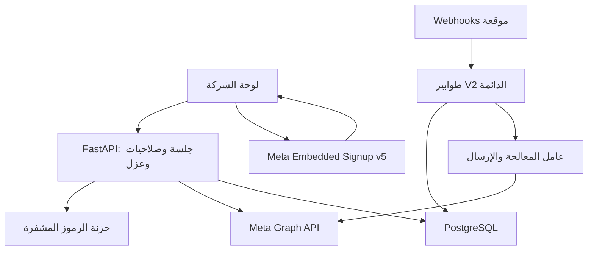
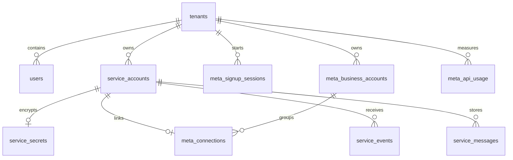
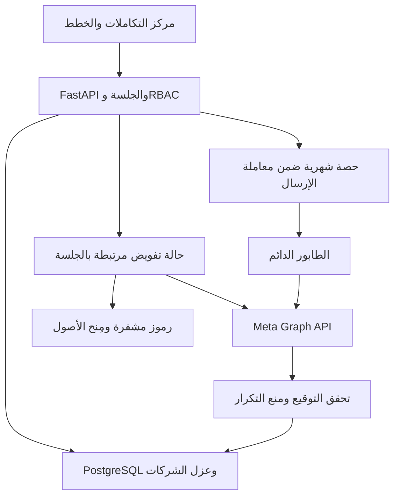

> سجل مرحلة سابقة: الحالة الحالية بعد استكمال التطوير في [تدقيق الإكمال](../../DEVELOPMENT_COMPLETION_AUDIT.md) و[دليل التشغيل الحالي](COMPLETION_OPERATIONS_AR.md). النواقص المذكورة أدناه تصف وقت التقرير ولا تمثل الحالة الحالية.

# وصلة — التدقيق والبنية الهندسية لتكامل Meta

تاريخ المراجعة: 18 نوفمبر 2026. هذا تسليم مرحلي برمجي، وليس اعتماد Tech Provider أو إطلاقًا تجاريًا.

## الأساس الذي فُحص قبل التعديل

المستودع `ibrahimtwaiti/Wasla`. الفرع `main` يحوي V1، بينما العمل الأحدث موجود في `feat/v2-social-service` وطلب الدمج #26. بُني هذا التغيير فوق V2 في فرع مستقل `feat/meta-provider-readiness`. لم يُعد بناء المشروع ولم تُحذف الوظائف القديمة. معلومات النشر السابقة في ملفات التسليم ليست تحققًا حيًا جديدًا من إعدادات Vercel أو Neon.

| المحور | الموجود في المصدر | التقييم والإجراء |
|---|---|---|
| الخادم | FastAPI، Python، HTTPX؛ index.py على Vercel | صالح للتوسعة بوحدات مستقلة |
| البيانات | PostgreSQL/psycopg للإنتاج، SQLite للتطوير؛ ترحيلات مرقمة | المحافظة على المحركين وإضافة migration 007/version 6 |
| الواجهة | JavaScript دون إطار تشغيل، CSS وهوية بنفسجية/صفراء، عربي/إنجليزي | إضافة قسم الربط داخل القنوات دون إعادة تصميم الموقع |
| الهوية | scrypt، جلسة cookie، CSRF، Origin، RBAC، إيقاف الشركة | أعيد استخدامها لكل مسار جديد |
| العزل | tenant_id وربط مركب للحسابات والرسائل | توسيع القيود المركبة لروابط Meta ومنع نقل الأصل بين الشركات |
| الأسرار | Fernet، مفتاح جذري خارج DB، إعدادات المدير مشفرة | تبادل الرمز خادميًا وحفظه بالخزنة الحالية |
| التشغيل | inbox/outbox دائم، deduplication، retries، unknown sends، scheduler | إعادة استخدام العامل؛ لا إنشاء طابور مكرر |
| واتساب | نصوص ووسائط محددة، قوالب، توقيع Webhook، حالات تسليم | الموجود مرشح يحتاج اختبارًا حيًا؛ أضيف مسار Embedded Signup |
| إنستغرام | Instagram Login، refresh، رسائل نصية | موجود في V2؛ لا ادعاء بتحقق حي جديد |
| لوحة المدير | إدارة الشركات والحسابات والإعدادات والتشخيص | إضافة حقول Meta من نفس اللوحة |
| النسخ والمراقبة | سكربتات R2 واستعادة وتنبيهات واحتفاظ | وجود المصدر لا يثبت تشغيل النسخ لهذه النسخة؛ يلزم اختبار restore بعد الترحيل |

## ما تغير فعليًا

- بدء جلسة Embedded Signup مرتبطة بالشركة والمستخدم وجلسة الدخول، مدة عشر دقائق، استخدام واحد.
- التقاط نتيجة v5، والتأكد من أصل postMessage تحديدًا، وعدم حفظ الكود أو الرموز في المتصفح.
- تبادل كود التفويض وفحص app_id، صلاحية الرمز، scopes وWABA target_ids خادميًا، ثم إثبات أن الرقم ضمن حساب الأعمال.
- حفظ الرمز مشفرًا، ورفض أصل مسجل لشركة أخرى، وإعادة الربط داخل الشركة نفسها دون نسخ سجل المحادثات.
- فصل حالة التفويض عن تسجيل الرقم واشتراك Webhooks وعن الاختبار الحي.
- مساران لتسجيل رقم Cloud API قياسي واشتراك الأحداث. PIN لا يُخزّن.
- عداد ومحاور أخطاء لعمليات الربط فقط، مع Rate Limit مشترك عبر DB.
- توثيق OpenAPI محمي، وواجهة عميل، وحقول إعداد Meta لدى مقدم الخدمة.
- إصلاح عودة رمز البيئة القديم بعد فصل الحساب: الحساب المفصول لا يستخدم fallback token.

## القيود والمشكلات التي ما زالت مفتوحة

1. فتح التسجيل الذاتي للشركات غير منفذ؛ الشركات تُنشأ باللوحة الموجودة. يلزم اعتماد نموذج الانضمام والتحقق من البريد وسياسات الخدمة قبل فتحه للعامة.
2. إطلاق Meta العام مغلق برمجيًا. يسمح التغيير فقط بوضع `test` مع قائمة شركات محددة؛ الإعداد لا يثبت موافقة Meta.
3. Messenger وPages وCatalogs وLead Ads وMarketing API غير منفذة. مصفوفتها في التقرير التالي، وليست أزرارًا تدعي تشغيلها.
4. Coexistence مستبعد من v5 في هذا التنفيذ؛ لا يجوز تطبيق register على رقم WhatsApp Business app قبل تنفيذ واختبار مساره الخاص.
5. فصل الحساب الحالي محلي: يمحو الرمز ويوقف استخدامه، ولا يعني إلغاء التفويض لدى Meta. Remote revocation وdeauthorization/data-deletion callbacks ومحو الشخص الكامل أعمال إطلاق لازمة.
6. استقبال messages/status موجود؛ account_update وتغير القوالب والأذونات وإلغاء التفويض تحتاج معالجة دورة حياة إضافية. لا تكفي مزامنة القوالب لإعلان اكتمال جميع webhooks.
7. مقاييس الإضافة تخص onboarding فقط. قياس كل طلب API والتكاليف والفوترة والحدود التجارية ليس مكتملًا.
8. لا يُعاد إرسال mutation تلقائيًا عند timeout. قد تكون Meta نفذت العملية؛ يلزم فحص حالتها قبل إعادة المحاولة. يلزم لاحقًا سجل عمليات تعافٍ أدق للتسجيل/الاشتراك.
9. جداول الجلسات المنتهية تُنظف عند بدء ربط جديد. سجلات الاستخدام تحتاج سياسة احتفاظ وفهرسة/تجميع دوري قبل الحجم الكبير.
10. موافقات حساب Meta وحالة Business Verification غير مرئية من المستودع، ولم يتم الوصول إلى حساب المطور في هذه الجولة.

## البنية التقنية

الفصل بين DB والشبكة مقصود: طلبات onboarding الخارجية خارج معاملات الكتابة. يُحجز state ذريًا قبل تبادل الكود؛ فشل التبادل يتطلب بدء جلسة جديدة. معاملات الكتابة تتحقق مجددًا من وضع الشركة وتمنع تغيير ملكية الأصل. لا تُوثق ملكية أصل اعتمادًا على معرّف يرسله المتصفح وحده.

## بنية قاعدة البيانات

| الجدول الجديد | الدور | قيد الأمان |
|---|---|---|
| meta_signup_sessions | بصمة state والمستخدم والجلسة وتاريخ الانتهاء وإصدار الإعداد | لا يخزن code/token؛ استهلاك ذري |
| meta_business_accounts | WABA/Messaging account وشركته | id فريد عالميًا و(id,tenant_id) فريد |
| meta_connections | الرقم الموجود في service_accounts وربطه بحساب الأعمال | مفتاحان خارجيان مركبان يمنعان تركيب شركة مع أصل شركة ثانية |
| meta_api_usage | العملية والحالة ورمز خطأ آمن والمدة والتاريخ | لا payload ولا token ولا عنوان طلب كامل |

`service_accounts.provider_id` يبقى معرّف الرقم في واتساب، وليس WABA. `business_account_id` هو المعرّف الذي تسميه استجابات v5 `messaging_account_ids`؛ لا يُختلق WAAC ID ولا تُرحل الأصول القديمة تلقائيًا.

## بنية الاشتراكات المستقبلية — تصميم فقط

جداول مقترحة: plans، plan_entitlements، tenant_subscriptions، usage_daily، invoices، invoice_lines، commercial_audit. ربطها بـ tenant_id؛ مبالغ بوحدات العملة الصغرى وعملة صريحة؛ فصل بنود رسوم وصلة عن تكلفة Meta المباشرة. لا جدول تحصيل أو بوابة دفع مفعلة بهذا التغيير. لا مشاركة credit line أو افتراض حق إعادة الفوترة.

## خطة التنفيذ والقبول

| المرحلة | الحالة الحالية | معيار القبول التالي |
|---|---|---|
| التدقيق | تم على main وV2 | مراجعة هذا التقرير |
| Meta Readiness | بحث موثق؛ الحساب غير مفحوص | App ID والنطاق وحالة التحقق والصلاحيات من البوابة الرسمية |
| Core | أعيد استخدام V2 وأضيفت قيود الربط | PostgreSQL CI واستعادة schema 6 |
| WhatsApp | مرشح معياري مع اختبارات اصطناعية | ربط حساب اختبار ثم تسجيل/اشتراك/وارد/صادر/تسليم حقيقي |
| Dashboard | واجهة الربط وحالاتها ومقاييس onboarding | اختبارات المتصفح والهاتف |
| بقية Meta | مصفوفة وتصميم؛ موصل IG موجود سابقًا | اختيار نطاق الخدمة وصلاحياته ثم تطوير مستقل |
| Security | اختبارات state والعزل والأسرار | callbacks دورة الحياة والمحو واختبار اختراق مع بيئة مماثلة للإنتاج |
| Production | غير معتمد | Meta + سياسة تشغيل/تسعير + أدلة حية + موافقة المالك على تغييرات الإنتاج |

## امتداد التنفيذ المستقل — 18 نوفمبر 2026

إعادة استخدام FastAPI وPostgreSQL والطابور والواجهة الحالية. لم ينشأ مشروع بديل أو مخزن أسرار آخر.

الجداول الجديدة:

| المجال | الجداول والعلاقات |
|---|---|
| تفويض التطبيقات | meta_grants يرتبط بحساب/شركة بمفتاح أجنبي مركب، ومعرف مستخدم Meta مجزأ حسب التطبيق؛ meta_callback_receipts لمنع التكرار |
| صفحات Facebook | meta_page_sessions حالة جلسة أحادية الاستخدام مع اختيار مشفر مؤقت؛ meta_page_connections مرتبط بحساب Messenger والشركة |
| التجارة التجريبية | service_plans، service_subscriptions لكل شركة مع لقطة ثابتة من الخطة، service_usage_counters بمفتاح شركة/شهر/مقياس |
| التسجيل والفواتير | service_registrations بحساب معطل للمراجعة؛ service_sandbox_invoices فريدة لكل شركة/شهر وغير قابلة للتحصيل |

ترحيل قيد channel يضيف messenger، مع المحافظة على الصفوف والمفاتيح المركبة. الرموز لا تعود للمتصفح، وحالات اختيار الصفحة مخزنة مشفرة وتنتهي بعد عشر دقائق. تبادل الكود ليس دليلًا على موافقات Meta أو التسليم الحي.

حدود التنفيذ: بوابة الفوترة تجريبية، لا معالجة مدفوعات ولا ضرائب؛ التحقق من البريد يدوي قبل التفعيل؛ لا دعم حاليًا لـ read watermarks أو نشر محتوى الصفحات أو Catalogs/Lead Ads/Marketing. واجهة حذف بيانات Meta الآلي ليست منفذة، وتظل بوابة إطلاق يجب تجهيزها مع سياسة الحذف القانونية قبل الإنتاج. محو الرمز عند الفصل لا يعني محو جميع سجلات العملاء. طلبات الإرسال التي كانت بالفعل قيد التنفيذ عند إلغاء التفويض قد تنتهي لدى المزود، بينما تحجب الطلبات المنتظرة.
