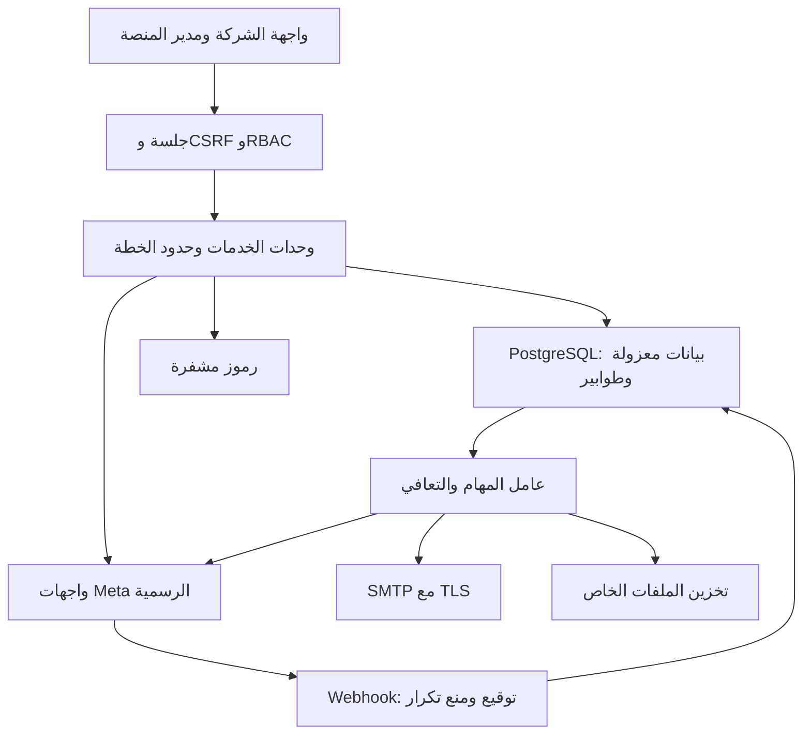

# استكمال Wasla V2 — التشغيل والعقود

18 نوفمبر 2026. المرجع الحالي للحالة هو `DEVELOPMENT_COMPLETION_AUDIT.md`؛ تقارير التدقيق السابقة تُحفظ كسجل تاريخي. لا نشر أو تعديل لإنتاج في هذه الجولة.

## البنية الحالية

schema 10 (`011_completion.sql`) يضيف: service_plan_limits، email_verifications/email_jobs، deletion_jobs/deletion_objects، meta_read_watermarks، meta_data_connections/meta_data_sessions/meta_data_records/meta_lead_events، meta_page_posts، worker_cursors. الربط بين اتصال بيانات وسجلاته يستخدم `(connection_id,tenant_id)`، وعزل الصفحات المشتركة بين Messenger وLead Ads يستخدم قفل PostgreSQL استشاريًا داخل المعاملة. المقاعد والعدادات تحجز تحت قفل صف الشركة. جلسات OAuth والمفاتيح لا تصل إلى متصفح العميل سوى state وكود التفويض المؤقت.

## تجهيز بيئة مستقلة

1. قاعدة PostgreSQL مستقلة، ثم `python -m wasla.cli init`. الترحيلات ضمن معاملة؛ لا migration ضمن طلب HTTP. لا تستخدم بيانات إنتاج للاختبارات.
2. مفتاح Fernet في `WASLA_TOKEN_ENCRYPTION_KEY`. بقية أسرار التطبيقات والخدمات تدار من لوحة مقدم الخدمة ومخزنة مشفرة. لا تدوير للمفتاح دون خطة إعادة تشفير وحفظ مفاتيح الاستعادة.
3. البريد: `WASLA_EMAIL_MODE=smtp`, `WASLA_EMAIL_ORIGIN` (origin HTTPS)، `WASLA_SMTP_HOST/PORT/FROM/USER/PASSWORD`. يعتمد SMTP على STARTTLS وشهادة موثوقة. `local` متاح فقط في development على localhost خارج Vercel؛ الرسالة مشفرة داخل قاعدة اختبار ويمكن قراءتها من تجهيز الاختبار فقط، ولا API إنتاج يكشف الرابط.
4. أنشئ خطة وحدودها من اللوحة، ثم `WASLA_SELF_SIGNUP_MODE=test`. ينشئ التسجيل شركة وحسابًا غير نشط وخطة تجريبية؛ تتفعل الجلسات بعد ضغط رابط البريد أحادي الاستخدام (ساعة). الرد على إعادة الإرسال موحد ولا يكشف وجود البريد.
5. إعدادات Meta الحالية، إضافة `META_CATALOG_CONFIG_ID`, `META_LEADS_CONFIG_ID`, `META_MARKETING_CONFIG_ID`. لكل خدمة configuration بصلاحياتها. `META_GRAPH_VERSION` مدعوم v25.0/v26.0. Marketing له `META_MARKETING_API_VERSION=v25.0` وفق جدول إصداراته المستقل، ولا يُرقّى آليًا لمجرد رقم في عنوان مثال.
6. Instagram يتطلب `INSTAGRAM_APP_ID/SECRET` و`WASLA_OAUTH_ORIGIN`. العودة `/api/v2/oauth/instagram/callback`. اكتشاف الحساب من تبادل الكود دون طلب ID/Token من العميل. لا افتراض تجديد WhatsApp أو Page tokens؛ إعادة التفويض عند الحاجة. تجديد Instagram مشروط برمز صالح عمره 24 ساعة على الأقل.
7. فعّل عامل HTTP المحمي `WASLA_WORKER_SECRET` أو `python -m wasla.worker`. يتناوب العامل على 8 أنواع مع claims تمنع تكرار المعالجة. احجز مدة استضافة مناسبة (يوصى 120 ثانية) للوسائط/SMTP، ومهلة trigger 80 ثانية؛ لا تُطلق سلسلة غير محدودة داخل request. وسّع العمال المتوازية وفق حجم الطابور وحدود Meta؛ لا تعتمد على cron بطيء في حمل كبير.
8. إعداد الفاحص ومخزن الملفات الخاص ثم اختبار حي. راقب الطوابير الثمانية، failed/unknown/blocked، وحالات البريد والحذف. SQL وHTTP fixtures لا يثبتان نجاح المخزن أو الفاحص الإنتاجي.

بعد موافقة المالك وإتمام المراجعات الفعلية يمكن التفعيل **من لوحة مقدم الخدمة دون تعديل شفرة**: `META_SIGNUP_MODE=enabled` مع `META_APPROVAL_REFERENCE` و`META_APPROVED_SERVICES` بقائمة الخدمات المعتمدة فقط (whatsapp, messenger, instagram, catalogs, leads, marketing). غياب المرجع أو الخدمة يغلق الربط؛ فحص الرمز والصلاحيات الفعلية يبقى إلزاميًا. المرجع سجل يقدمه المدير، وليس تحققًا آليًا من اعتماد Meta أو ادعاء شراكة. فتح التسجيل يتطلب `WASLA_SELF_SIGNUP_MODE=enabled` مع `WASLA_SIGNUP_APPROVAL_REFERENCE` وإصدار شروط `WASLA_SIGNUP_TERMS_VERSION`؛ تُرفض موافقة العميل على نسخة قديمة. الاشتراك يبدأ trial ولا تحصيل فعلي. **لم نضبط هذه القيم في أي بيئة إنتاج.**

## واجهات جديدة

كل كتابة داخلية تتطلب JSON وOrigin مطابقًا وCSRF مع جلسة مخولة، عدا واجهات التسجيل/تحقق البريد العامة ذات الحدود التشغيلية. `/api/v2/meta/messenger/metrics` يحتاج reports؛ إدارة القنوات والخطط تحتاج settings. التفويض العام للمدير يتم فقط عبر `/api/admin/workspaces/{tenant}/meta-data/...`، وليس tenant يرسله العميل في JSON.

| المسار | الوظيفة |
|---|---|
| GET /api/public/plans | خطط متاحة وحدودها وحالة التسجيل |
| POST /api/auth/register | شركة + مستخدم غير نشط + خطة + رسالة تحقق |
| POST /api/auth/verification/resend, /complete | إعادة إرسال/استهلاك رمز التحقق |
| GET /api/v2/email-status | حالة البريد للحساب الحالي |
| GET /api/v2/billing; POST /billing/plan, /billing/invoice | استهلاك واختيار خطة ومسودة فاتورة غير قابلة للدفع |
| PATCH /api/admin/commerce/plans/{id} | تعديل الخطة؛ الاشتراكات السابقة ثابتة حتى إعادة الإسناد |
| GET /api/admin/email/jobs; POST /{id}/retry | فشل تسليم البريد وإعادة المحاولة قبل الانتهاء |
| GET /api/v2/meta/data | الخدمات وأسباب إغلاق الربط والاتصالات |
| POST /api/v2/meta/data/{kind}/start, /exchange, /connect | state، تبادل خلفي واختيار أصل مصرح به |
| POST /api/v2/meta/data/{id}/sync | صفحة منتجات/Insights/نماذج؛ after cursor على host ثابت |
| GET /api/v2/meta/data/{id}/records | بيانات مشفرة مخزنة مفكوكة فقط للمخول مع pagination |
| POST /api/v2/meta/data/{id}/forms/{form}/sync | leads لنموذج اكتُشف من الصفحة نفسها |
| POST /api/v2/meta/data/{id}/leads/subscribe | الاشتراك بـ leadgen مع الحفاظ على الحقول الأخرى |
| GET /api/v2/meta/data/{id}/events; POST /events/{event}/retry | سجل Lead Ads وحالات فشله |
| POST /api/v2/meta/data/{id}/token-health, /disconnect | صحة/إلغاء رمز محلي؛ لا إلغاء عشوائي لتفويض مشترك |
| GET/POST /api/v2/meta/pages/{id}/posts | سجل نشر نصوص ومهمة نشر صريحة مع Idempotency-Key وPUBLISH |
| GET /api/v2/meta/messenger/metrics | قراءات مسجلة محليًا؛ المقاييس غير المتاحة null |
| GET /api/v2/meta/instagram; POST /start | جاهزية وبدء ربط حساب Instagram مكتشف رسميًا |
| POST /api/v2/privacy/deletions | user / tenant / account، كلمة مرور وDELETE |
| GET /api/privacy/deletions/{id} | حالة عامة بمعرف عشوائي؛ لا بريد أو أسماء أو محتوى |
| GET /deletion-status?request={id} | صفحة حالة مفهومة لصاحب الطلب |
| POST /api/webhooks/meta/data-deletion, /instagram/data-deletion | signed_request ثم confirmation_code وURL |
| POST /api/webhooks/meta/deauthorize, /instagram/deauthorize | callback إلغاء التفويض بمفتاح التطبيق المناسب |
| GET /api/admin/privacy/deletions, /holds | متابعة العمليات والحجوزات |
| POST /api/admin/privacy/deletions/{id}/retry, /holds/release | إعادة محاولة ورفع حجز مخول بمبرر |
| GET /api/v2/openapi.json | المخطط الحالي المحمي؛ نسخة ثابتة في docs/openapi.json |

401 مصادقة؛ 403 صلاحية/state/signature؛ 404 خارج الشركة؛ 409 تعارض/سعة خطة/شرط ناقص؛ 422 مدخلات منقحة؛ 429 rate/monthly quota؛ 502 خطأ مزود منقح؛ 503 تهيئة/تشفير. Graph errors تحفظ codes فقط. لا إعادة تلقائية لعملية نشر أو رسالة ذات نتيجة مبهمة؛ تصبح unknown للمراجعة.

## دورة الحذف والاستعادة

الطلب يعطل الجلسات والوصول ويزيل الرموز المستخدمة فورًا. عامل الحذف يحاول الإلغاء الخارجي المؤهل، يمحو نسخة الاعتماد اللازمة للمحاولة، ثم يفحص الحجوزات القانونية. لا يدّعي إلغاء grant مشترك خارج نطاق الأصل؛ يسجل requires_meta_review. يحذف الملفات قبل قاعدة البيانات، وينتظر إنهاء مهام إرسال قيد التنفيذ. الفشل يبقى retry؛ لا نصف purge ملتزم بسبب savepoint. الحسابات/الشركة تحذف بالترتيب الذي يحترم FK، والمستخدم فقط تتم مجهلة هوية مرجعه في السجلات المشتركة.

السجل الأدنى للحذف (معرفات فقط) يبقى للمراجعة ومنع إعادة البيانات عند الاستعادة. نسخ 30 يومًا لها lifecycle مستقل يجب التحقق منه في مخزن الإنتاج؛ لا ادعاء محو نسخة احتياطية فوريًا. لا حد احتفاظ قانوني مفترض لكل بيانات الشركة: عند وجود التزام موثق يستخدم hold مع مراجعة مخولة، ولا يغيّر برنامج الحذف قرارات قانونية تلقائيًا.

فصل Lead Ads وإزالته يحاول حذف اشتراك leadgen وحده مع إبقاء حقول Messenger الأخرى. فشل الإلغاء لا يمنع محو الرمز المحلي، ويظهر `not_confirmed` للمستخدم. لا يُلغى تفويض مستخدم يشمل أصولًا أخرى عشوائيًا. تزال أسباب الحجوزات المنتهية المرتبطة بالسجلات المحذوفة، ويحذف سجل WABA بعد إزالة آخر رقم مرتبط به فقط.

قبل الاستعادة: صدّر سجلًا حديثًا إلى مكان خاص خارج النسخة القديمة: `python -m scripts.deletion_ledger export /secure/erasure-ledger.json`. لا يستبدل ملفًا موجودًا وصلاحيته 0600. بعد استعادة نسخة إلى قاعدة **معزولة**: `python -m scripts.deletion_ledger replay /secure/erasure-ledger.json` ثم نفس الأمر مع `WASLA_ENV=restore` و`--apply`. يعالج الأمر طلبات المحو المحددة محليًا، ويخرج بخطأ إذا بقي حجز أو محاولة معلقة. أبقِ العامل العام متوقفًا وبيانات اعتماد الخدمات الخارجية معزولة طوال الاستعادة. لا تُفتح قاعدة مستعادة للعملاء قبل اكتمال ذلك. التراجع عن الإصدار لا يحذف جداول جديدة؛ انشر إصدارًا متوافقًا أو استعد إلى قاعدة مستقلة وفق إجراء مخول.

## المصادر الرسمية المراجعة

- [Graph وMarketing versions](https://developers.facebook.com/docs/graph-api/changelog/versions/): الجدول يعرض Graph v26.0/v25.0 وMarketing v25.0؛ بعض أمثلة المراجع بعنوان v27.0، وليست سببًا لترقية عمياء.
- [Business catalogs](https://developers.facebook.com/docs/business-management-apis/business-asset-management/guides/catalog): owned_product_catalogs/client_product_catalogs. [Catalog permission](https://developers.facebook.com/docs/facebook-business-extension/fbe/faqs): catalog_management ومراجعة التطبيق؛ business_management لاكتشاف أعمال المستخدم.
- [Lead Ads Webhooks](https://developers.facebook.com/docs/graph-api/webhooks/getting-started/webhooks-for-leadgen/): leads_retrieval، pages_show_list، pages_read_engagement، pages_manage_metadata، ads_management، مع task ADVERTISE والوصول إلى leads. التسليم يشير إلى lead ID، ويسترجع العامل البيانات بصلاحية الصفحة.
- [Ad Account Insights](https://developers.facebook.com/docs/marketing-api/reference/ad-account/insights/): تقارير حساب مفوض عبر ads_read. لا كود إنشاء حملات أو إنفاق.
- [Page webhook reference](https://developers.facebook.com/docs/graph-api/webhooks/reference/page/): message_reads إلى جانب الرسائل والتسليم. تحفظ وصلة watermark لكل حساب/شخص وتعرض ملاحظات نطاق البيانات.
- [Page feed publishing](https://developers.facebook.com/docs/graph-api/reference/page/feed/): Page token وصلاحيات pages_manage_posts/pages_read_engagement/pages_show_list ومهمة CREATE_CONTENT. لا تمنح واجهة وصلة هذه الصلاحيات بذاتها.
- [Instagram Business Login](https://developers.facebook.com/documentation/instagram-platform/instagram-api-with-instagram-login/business-login): professional account، scopes instagram_business_basic/manage_messages، تبادل الرمز وتجديد الصالح المدعوم عبر الخادم، وAdvanced Access لخدمة حسابات الغير.

التفعيل الحي يحتاج حسابات حقيقية وصلاحيات ممنوحة وتهيئة callbacks وSMTP والتخزين. لم نرسل App Review أو نفعّل دفعًا أو ننشر إنتاجًا.
